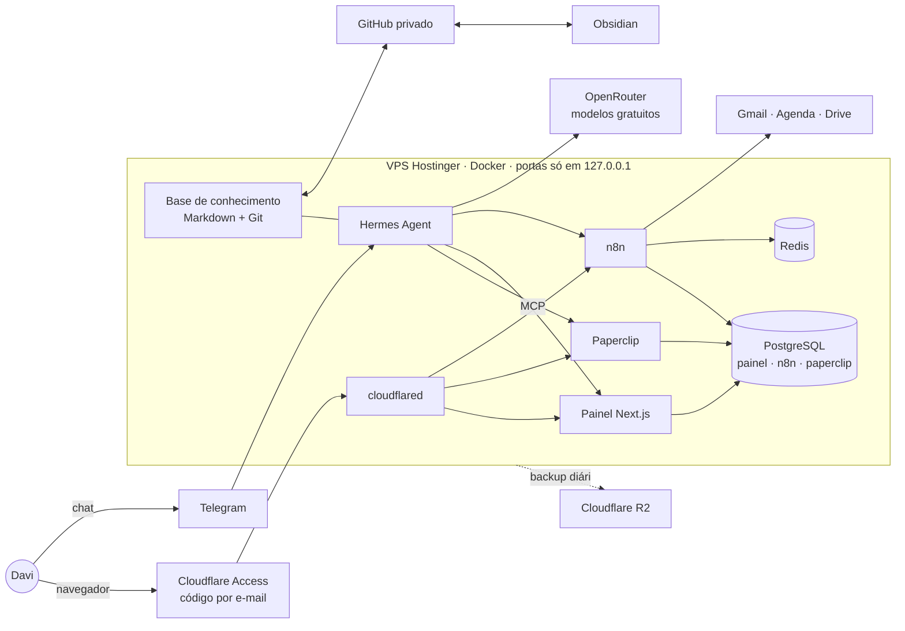

# TRD – Segundo Cérebro da Asttra Labs

Oct 31, 2026 · @Davi Marques Oliveira

Este documento define como o segundo cérebro descrito no PRD será construído: arquitetura, componentes, dados, segurança e integrações.

## Arquitetura

O Telegram fala direto com o Hermes, que consulta o Paperclip antes de agir e usa o n8n para as integrações. O acesso web ao painel, ao Paperclip e ao n8n entra pelo `cloudflared`, depois do login da Cloudflare. Nenhuma porta além do SSH fica aberta.

## Componentes

Todos os serviços rodam em containers Docker no VPS, definidos em um único Docker Compose versionado no Git. A soma estimada fica em torno de 5 GB dos 8 GB disponíveis.

| Serviço | Função | Memória estimada | Fonte da estimativa |
| --- | --- | --- | --- |
| Hermes Agent | Orquestrador, conversa pelo Telegram, executa tarefas | \~1 GB | [Hostinger](https://www.hostinger.com/de/tutorials/?p=11258): o container usa cerca de 1 GB |
| Paperclip | Organograma, tarefas, aprovações, orçamento e auditoria | \~1 GB | [Railway](https://railway.com/deploy/paperclip-ai-agent-company-os-current-release-no-build-step--paperclip-or-ai-agent-company-os-current): confortável com cerca de 1 GB parado |
| n8n | Automações e integrações | \~1 GB | Estimativa; [is\*hosting](https://blog.ishosting.com/en/self-host-n8n-requirements): 8 GB comportam n8n, PostgreSQL e Redis |
| PostgreSQL | Instância única, um banco lógico por serviço (painel, n8n, Paperclip) | \~0,5 GB | Estimativa, a medir |
| Redis | Filas e cache, compartilhado | \~0,1 GB | Estimativa, a medir |
| Painel | Interface web em Next.js: visão geral e módulos de negócio, incluindo o CRM | \~0,5 GB | Estimativa, a medir |
| cloudflared | Túnel até a Cloudflare, sem portas abertas | \~0,1 GB | Estimativa, a medir |
| Sistema operacional | Ubuntu, Docker, Fail2ban | \~0,5 GB | Estimativa, a medir |

Nada depende de sistemas anteriores: o módulo de conteúdo será criado do zero, numa fase futura. Todas as estimativas serão substituídas por medições reais (`docker stats`) na implantação.

## Rede e segurança

Nenhum serviço é acessado diretamente pela internet: todo acesso web passa pela Cloudflare, e o servidor só aceita SSH por chave.

- **Cloudflare Tunnel:** o container `cloudflared` abre uma conexão de saída até a Cloudflare. Nenhuma porta web é aberta no firewall.
- **Cloudflare Access:** cada serviço web (painel, Paperclip, n8n) fica atrás de uma tela de login da Cloudflare, liberada só para o e-mail de Davi. O plano gratuito cobre até 50 usuários, com retenção de logs de 24 horas ([Costbench](https://costbench.com/software/business-vpn/cloudflare-zero-trust/free-plan/)).
- **Subdomínios:** `painel.asttralabs.com.br` e `agentes.asttralabs.com.br` (Paperclip), no ar. `automacoes.asttralabs.com.br` (n8n) ainda é proposto. Todos com o proxy da Cloudflare ligado.
- **Containers:** portas publicadas só em `127.0.0.1`, porque o Docker ignora o UFW. Os serviços conversam entre si por uma rede Docker interna.
- **Hermes isolado:** comandos executados pelo agente rodam em container separado (`terminal.backend docker`), com modo de aprovação ligado (`approval_mode ask`). O gateway do Telegram só faz conexões de saída.
- **Segredos:** chaves de API, tokens e senhas ficam em arquivos `.env` fora do Git, com permissão restrita ao usuário do serviço. Nunca entram na base de conhecimento nem nas mensagens.
- **Skills de terceiros:** só de publicadores verificados e após revisão do código.

## Dados

Dados estruturados ficam no PostgreSQL; conhecimento fica em arquivos Markdown num repositório Git. Os dois têm cópia diária no Cloudflare R2.

**Banco único (PostgreSQL)**

- Uma instância, com um banco lógico por serviço: `painel`, `n8n` e `paperclip`. Cada serviço tem usuário próprio, sem acesso aos bancos dos outros.
- O banco `painel` é a fonte única do negócio: leads, contatos, empresas, oportunidades, projetos, conteúdos e indicadores. Tarefas e aprovações ficam no Paperclip, e o painel as mostra pela API dele.
- Agentes acessam os dados do negócio pela API do painel, nunca direto no banco. Assim cada leitura e escrita passa pelas regras de permissão e fica registrada.

**Base de conhecimento (Markdown + Git)**

- Um repositório privado no GitHub (`davimqz/asttra-conhecimento`), com as pastas por departamento definidas no PRD.
- O servidor mantém uma cópia local, que o Hermes lê e na qual propõe alterações.
- Davi edita pelo Obsidian, sincronizando com o mesmo repositório pelo plugin Obsidian Git.
- Alterações feitas por agentes entram como commits identificados, para revisão no histórico.

**Backups (Cloudflare R2)**

- Diariamente: dump de cada banco, cópia dos volumes Docker com dados e dos arquivos de configuração (sem os segredos em texto puro).
- Retenção: 7 cópias diárias e 4 semanais, dentro dos 10 GB gratuitos.
- A base de conhecimento já tem uma segunda cópia no GitHub.
- Um teste de restauração por mês confirma que os backups funcionam.

## Integrações

O Hermes conversa com Davi; o n8n faz as integrações com serviços externos; o Paperclip controla o que precisa de aprovação.

| Integração | Como conecta | Fase |
| --- | --- | --- |
| Telegram | Gateway do Hermes, com bot próprio e acesso restrito ao usuário de Davi | MVP |
| Gmail, Google Agenda e Drive | n8n com OAuth do Google; o Hermes chama fluxos do n8n como ferramentas | MVP |
| Paperclip | Adaptador oficial `hermes-paperclip-adapter`, mantido pela Nous Research | MVP |
| Construção de fluxos | `n8n-mcp` + skills `n8n-skills`, usados pelo Claude Code para criar fluxos que Davi revisa | MVP |
| WhatsApp | API oficial da Meta (Cloud API), via gateway do Hermes ou Evolution API | Fase 2 |
| E-mail Hostinger | IMAP e SMTP pelo n8n | Fase 2 |
| Voz | A definir na fase 2 | Fase 2 |
| Instagram, X, Threads, LinkedIn, TikTok e YouTube | APIs oficiais de cada rede pelo n8n; publicação só com aprovação | Fase 2 |

**Modelo de IA**

- **Modelos gratuitos** pelo OpenRouter, configurados no Hermes. Há limite de requisições por dia.
- **Sem modelo pago de reserva por enquanto.** Quando o limite diário for atingido, o painel mostra um aviso, e Davi decide o que fazer.
- **Regra de dados:** conteúdos sensíveis de clientes não devem ser enviados a modelos gratuitos cujos termos permitam usar os dados para treinamento. A lista de modelos permitidos será definida na implantação, após ler os termos de cada um.

## Decisão do CRM

Decisão de Davi em 31/10/2026: o CRM será um **módulo próprio do painel**, construído do zero no banco único. No MVP ele cobre o essencial: contatos, empresas, oportunidades e funil de vendas; o restante cresce por fases. Opções avaliadas e descartadas: Twenty (pesado, cerca de 2 GB), EspoCRM, Krayin, Dolibarr e Atomic CRM. Comparativo usado na decisão:

| Opção | Prós | Contras |
| --- | --- | --- |
| **Módulo próprio do painel** (recomendada) | Fonte única de verdade; mesma stack (Next.js, PostgreSQL, Drizzle); feito sob medida; consumo baixo de memória; sem restrição de licença para replicar | Recursos de CRM avançado precisam ser construídos aos poucos |
| **[Twenty](https://github.com/twentyhq/twenty)** | CRM open-source mais citado, cerca de 40 mil estrelas e bem avaliado ([Marmelab](https://marmelab.com/blog/2026/01/09/open-source-crm-benchmark-2026)) | Base de código grande; exige servidor, worker e Redis próprios, pesando nos 8 GB; licença AGPL; dados ficam fora do banco do painel |
| **[Atomic CRM](https://marmelab.com/blog/2026/01/09/open-source-crm-benchmark-2026)** | Pequeno, fácil de adaptar, pensado como base para um CRM próprio | Depende do Supabase como backend; o comparativo é publicado pelos próprios autores |

O módulo de conteúdo será criado do zero em fase futura, sem depender de sistemas anteriores.

## Mapa de conhecimento para agentes

Decisão de Davi em 31/10/2026: usar o [Graphify](https://github.com/Graphify-Labs/graphify) para transformar a base de conhecimento e o código do painel num grafo de relações que os agentes consultam em vez de ler arquivo por arquivo.

- **O que mapeia:** a base de conhecimento (Markdown dos 5 departamentos) e, quando existir, o repositório do painel.
- **Quem usa:** o Claude Code durante a construção e o Hermes no dia a dia; o Graphify tem instalação específica para os dois.
- **Custo:** código é lido localmente, sem IA; documentos usam o modelo configurado (gratuito).
- **Quando:** no início da construção, depois que houver documentos e código para mapear. Licença Apache-2.0.

## Custos, riscos e perguntas em aberto

O custo mensal do MVP fica no valor do servidor; todo o software e os serviços de apoio usam planos gratuitos.

| Item | Custo mensal |
| --- | --- |
| VPS Hostinger KVM 2 (24 meses pagos) | Cerca de US$ 7 |
| Hermes, Paperclip, n8n, PostgreSQL, Redis | Gratuito (open-source) |
| Cloudflare Tunnel, Access e R2 | Gratuito dentro dos limites |
| Modelos de IA | Gratuito; ao atingir o limite, o painel avisa |
| Google Drive e Agenda | Gratuito (15 GB) |

**Riscos técnicos**

| Risco | Mitigação |
| --- | --- |
| Paperclip executa os agentes dentro do próprio container, sem isolamento | Rodar o Hermes em container separado, com execução de comandos isolada |
| Login de agentes pela interface do Paperclip falha em instalações próprias, segundo o [modelo da Railway](https://railway.com/deploy/paperclip-agent-orchestration) | Configurar credenciais por variável de ambiente e testar o adaptador do Hermes antes do restante |
| Memória apertada | Limites de memória por container no Compose; medir a cada serviço novo |
| Conflitos de edição na base de conhecimento entre Obsidian e agentes | Agentes trabalham em ramos separados ou commits pequenos, com revisão |
| Limites dos modelos gratuitos | Aviso no painel quando o limite for atingido; Davi decide se adota um modelo pago |

**Perguntas em aberto para Davi**

- [x] CRM: módulo próprio no painel, construído do zero.
- [x] Modelo de IA: só gratuitos, com aviso no painel ao atingir o limite.
- [ ] Resolvido: subdomínios atrás do login da Cloudflare (Access), liberados só para o e-mail de Davi, que deve ter verificação em duas etapas.
