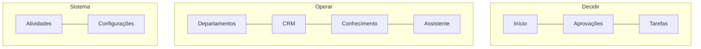
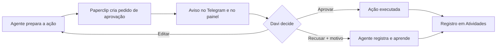

# App Flow – Segundo Cérebro da Asttra Labs

Oct 31, 2026 · @Davi Marques Oliveira

Davi usa o segundo cérebro por dois caminhos: o painel web, para ver e decidir, e o Telegram, para conversar e aprovar de qualquer lugar. Este documento mostra as telas do painel e os fluxos principais. É uma proposta para validação.

## Mapa de telas

O menu lateral do painel agrupa as telas pelo que Davi vai fazer nelas. Início é a tela de entrada; Configurações tem atalhos para as interfaces do Paperclip e do n8n.

## Telas do MVP

O painel tem 9 telas no MVP. O Paperclip e o n8n mantêm as próprias interfaces, abertas a partir do painel quando for preciso configurar algo.

| Tela | O que mostra | O que Davi faz nela |
| --- | --- | --- |
| **Início** | Os 5 indicadores, aprovações pendentes, tarefas de hoje, próximos compromissos e avisos do sistema (como o limite diário da IA) | Ter a visão geral em segundos e ir direto ao que precisa de atenção |
| **Aprovações** | Tudo o que os agentes prepararam e aguarda decisão, com o conteúdo completo e o motivo | Aprovar, editar antes de aprovar ou recusar com um comentário |
| **Tarefas** | Tarefas de todos os departamentos, com responsável (Davi ou agente), prazo e status | Criar, atribuir, mudar status, filtrar por departamento |
| **Departamentos** | Uma página para cada um dos 5, com indicadores, tarefas e documentos da área | Acompanhar e agir dentro de um departamento |
| **CRM** | Contatos, empresas e oportunidades, com o funil de vendas em colunas | Cadastrar, mover oportunidades no funil, ver o histórico de cada contato |
| **Conhecimento** | As pastas da base de conhecimento, com busca | Ler, buscar e abrir no Obsidian para editar |
| **Assistente** | Conversa com o Hermes, igual à do Telegram | Pedir tarefas, perguntas e resumos pelo navegador |
| **Atividades** | Registro de tudo o que agentes e Davi fizeram: o quê, quando, quem aprovou | Auditar e encontrar o que aconteceu |
| **Configurações** | Integrações conectadas, status do modelo de IA, atalhos para o Paperclip e o n8n, e a seção Aparência (temas) | Conectar contas e verificar se tudo está funcionando |

## Fluxo de aprovação

Vale para tudo o que sai da empresa ou não pode ser desfeito: e-mails, mensagens, posts, gastos e exclusões. Leitura, rascunhos e tarefas internas não passam por aqui.

## Fluxos pelo Telegram

O Telegram é o atalho do dia a dia: tudo o que dá para fazer nele também fica registrado no painel.

**Ideia para depois (fora do MVP):** um resumo diário automático no Telegram.

Fica registrado só como possibilidade; entra quando Davi pedir.

**Pedir uma tarefa**

1. Davi escreve em linguagem natural: "prepara um follow-up para o lead da empresa X".
2. O Hermes identifica o departamento (Crescimento) e cria a tarefa no Paperclip.
3. O agente faz o trabalho com a skill certa e devolve o resultado.
4. Se o resultado sai da empresa (um e-mail, por exemplo), vira um pedido de aprovação.

**Aprovar pelo celular**

1. Chega no Telegram: o que o agente quer fazer, o conteúdo e três botões: Aprovar, Editar, Recusar.
2. Aprovar executa a ação. Editar abre a conversa para ajustar o texto. Recusar pede um motivo, que o agente usa para aprender.
3. A decisão fica registrada em Atividades no painel.

## Fluxo de um lead novo

Um lead entra no CRM, é qualificado pelo agente de Crescimento e recebe follow-up só depois da aprovação de Davi.

1. **Entrada:** o lead chega pelo formulário do site (que já envia e-mail para contato@), por e-mail ou é cadastrado por Davi no CRM. O n8n detecta e cria o contato.
2. **Qualificação:** o agente de Crescimento usa a skill "qualificar lead": resume quem é, o que pediu e sugere o próximo passo.
3. **Aviso:** Davi recebe no Telegram um resumo do lead.
4. **Resposta:** se Davi pedir, o agente prepara a resposta com a skill "follow-up" e envia para aprovação.
5. **Envio:** aprovado, o e-mail sai pelo Gmail e a oportunidade avança no funil do CRM.

## Aparência: editar e carregar temas

Pedido de Davi em 31/10/2026: um lugar no próprio painel para editar o visual e carregar um design system. No MVP entram os passos 1, 2 e 5 (ver, carregar e aplicar temas); edição com prévia, checagem de contraste e exportação ficam para uma fase seguinte.

1. Em Configurações › Aparência, Davi vê os temas instalados (Selecta é o primeiro) e qual está ativo.
2. **Carregar tema:** envia um arquivo de design system (o mesmo formato `tokens.json` do Selecta). O painel valida o arquivo e mostra o que falta ou não é compatível.
3. **Editar:** ajusta cores (claro e escuro), fontes e cantos, com uma prévia ao vivo das telas.
4. **Verificação de contraste:** o editor avisa quando uma cor de texto não passa no mínimo de leitura.
5. **Aplicar:** salva o tema e o ativa; o anterior continua disponível para voltar.
6. **Exportar:** baixa o tema como arquivo, para reaproveitar ou levar para outro painel (por exemplo, o de um cliente).

## Perguntas em aberto

- [x] Resumo diário: fora do MVP, só quando Davi pedir.
- [x] Revisão semanal: não, por enquanto.
- [x] As 9 telas do MVP estão aprovadas por enquanto.
- [x] Follow-up automático após alguns dias: fora do MVP.
